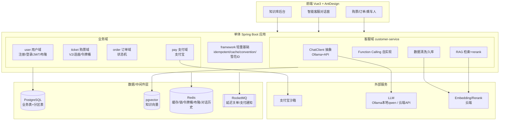
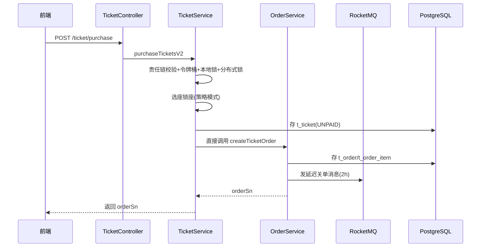
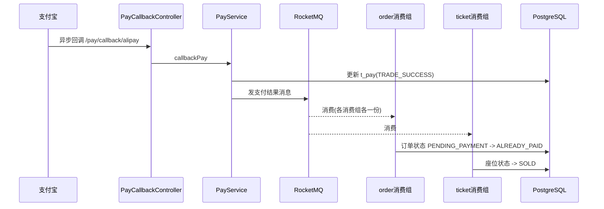
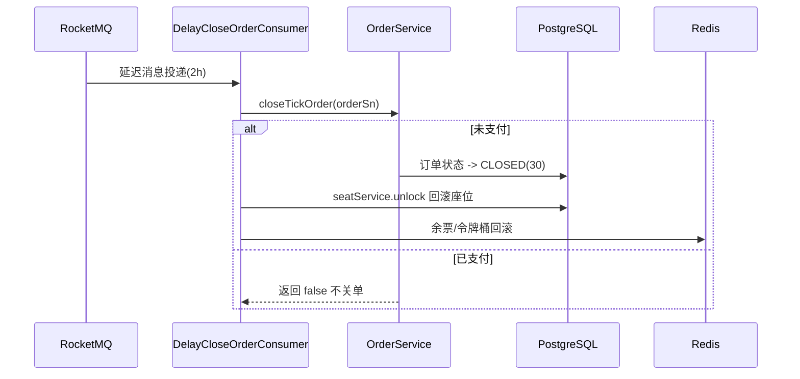
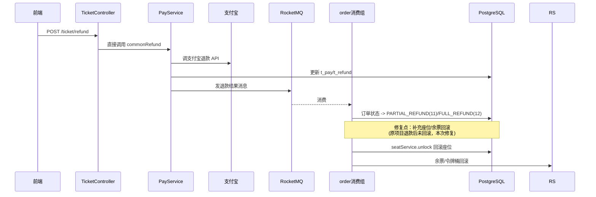
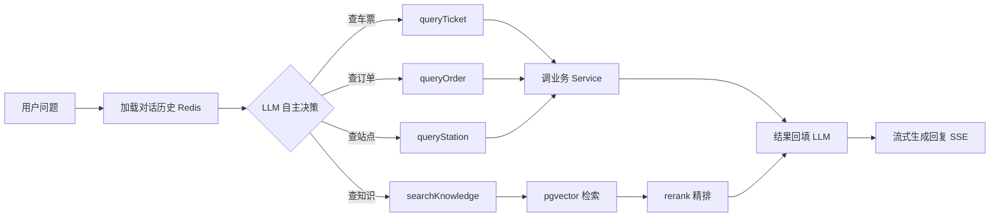

# 12306 重构版架构设计

## 一、项目定位

12306 铁路购票系统的重构版，单体 Spring Boot 架构，定位为简历项目（找实习）。在保留高并发设计亮点的前提下简化架构，并新增智能客服（Agentic RAG + Function Calling）作为 AI 应用亮点。技术栈升级到 PostgreSQL + pgvector，自研 starter 换为开源组件。

**设计目标**
- 架构简化：单体替代微服务，去掉治理中间件
- 性能优化：保留令牌桶/多级锁/布隆过滤器等高并发设计
- 技术栈升级：PostgreSQL + pgvector + jjwt 升级
- AI 亮点：智能客服（RAG + Function Calling）

---

## 二、技术栈

| 层面 | 选型 | 说明 |
|------|------|------|
| 语言/框架 | Java 17 + Spring Boot 3 | 单体多模块 Maven |
| 数据库 | PostgreSQL + 分区表 | 替代 MySQL+ShardingSphere，保留分片设计 |
| 向量库 | pgvector | 复用 PG，零额外中间件 |
| 缓存/分布式锁 | Redis + Redisson | 缓存、锁、令牌桶、布隆过滤器 |
| 消息队列 | RocketMQ | 延迟关单 + 支付成功异步通知 |
| ORM | MyBatis-Plus | 与 PG 协同 |
| 认证 | JWT（jjwt 0.11+） | 升级老版本 |
| 支付 | 支付宝沙箱 | 策略模式预留多渠道 |
| AI 对话 | 自实现 ChatClient | Ollama(本地qwen) + OpenAI 兼容 API |
| Embedding | 云端强力模型 | 非本地 |
| Rerank | 云端 rerank | 借鉴 BaiLian 实现 |
| 文档解析 | Apache Tika + 自实现 Markdown | + OcrParser 预留接口 |
| 本地缓存 | Caffeine | V2 本地锁 |
| 前端 | Vue 3 + Ant Design Vue | + 客服对话窗 |

---

## 三、整体架构图



---

## 四、模块划分

```
12306-new/
├── dependencies/             # BOM 依赖版本管理
├── framework/                # 轻量基础层（非重型 starter）
│   ├── convention/           # 统一返回/异常（@RestControllerAdvice）
│   ├── cache/                # Spring Cache + Redisson 封装
│   ├── idempotent/           # 幂等注解 + AOP + Redis（自实现）
│   └── distributedid/        # 雪花算法
├── app/                      # 单体启动应用
│   └── src/main/java/.../
│       ├── user/             # 用户域（注册/登录/乘车人）
│       ├── ticket/           # 购票域（V2/选座/余票）
│       ├── order/            # 订单域（状态机/查询）
│       ├── pay/              # 支付域（支付宝/回调/退款）
│       ├── customerservice/  # 智能客服（ChatClient/FC/RAG/数据清洗/知识库后台）
│       └── common/           # 公共配置/拦截器
├── frontend/                 # Vue3 + AntDesign
└── resources/                # PG 建表+分区+pgvector+知识库种子数据
```

**关键变化**：单体下 `ticket -> order` 不再用 Feign，改为同应用内直接方法调用，但保留领域边界（按包划分）。

---

## 五、核心调用链路

### 5.1 购票下单



### 5.2 支付与延迟关单



延迟关单（2h 后）：



### 5.3 退款（含修复座位回滚缺口）



### 5.4 智能客服（RAG + Function Calling 融合）

核心思路：把知识库检索包装成一个工具，与业务查询工具并列，由 LLM 自主决策路由。



### 5.5 知识库入库


---

## 六、数据存储设计

### 6.1 PostgreSQL 业务表 + 分区表

| 表 | 分区键 | 说明 |
|----|--------|------|
| `t_user` | username | 用户主表，按 username 分区 |
| `t_user_phone` | phone | 手机号索引表（反查 username） |
| `t_user_mail` | mail | 邮箱索引表（反查 username） |
| `t_order` | order_sn/user_id | 订单主表 |
| `t_order_item` | order_sn | 订单明细 |
| `t_ticket` | train_id/username | 车票表 |
| `t_seat` | train_id | 座位表 |
| `t_pay` / `t_refund` | order_sn | 支付/退款单 |

**读请求扩散解决**：登录时输入手机号/邮箱，先查 `t_user_phone`/`t_user_mail` 定位 username 分片键，再精确路由 `t_user`，避免全分区扫描。

### 6.2 pgvector 知识向量表

```sql
CREATE TABLE knowledge_chunk (
    id BIGSERIAL PRIMARY KEY,
    kb_category VARCHAR(64) NOT NULL,   -- 知识库分类（退改规则/购票流程/证件要求/自定义）
    doc_id VARCHAR(64) NOT NULL,        -- 来源文档 ID
    content TEXT NOT NULL,              -- 切片文本
    embedding vector(1024),             -- 向量（维度按 embedding 模型定）
    metadata JSONB,                     -- 元数据（标题/来源等）
    create_time TIMESTAMP DEFAULT NOW()
);
CREATE INDEX ON knowledge_chunk USING hnsw (embedding vector_cosine_ops);
CREATE INDEX ON knowledge_chunk (kb_category);
```

### 6.3 Redis 键设计

| 用途 | Key 模式 |
|------|----------|
| 登录态 | `login:token:{accessToken}` |
| 余票 | `train:remaining_ticket:{trainId}_{start}_{end}` (Hash) |
| 令牌桶 | `ticket:availability_token_bucket:{trainId}` (Hash) |
| 布隆过滤器 | `user_register_bloom_filter` |
| 对话历史 | `chat:history:{sessionId}` |
| 幂等键 | `idempotent:{prefix}:{key}` |
| 购票锁 | `lock:purchase_tickets:{trainId}` |

---

## 七、外部依赖

| 依赖 | 用途 | 是否必须 |
|------|------|----------|
| Redis（Redisson） | 缓存/锁/令牌桶/布隆/对话历史 | 强必须 |
| RocketMQ | 延迟关单/支付通知 | 强必须 |
| PostgreSQL + pgvector | 业务数据 + 知识向量 | 强必须 |
| 支付宝沙箱 | 支付/退款 | 必须有支付渠道 |
| LLM（Ollama/云端API） | 客服对话 + 工具决策 | 智能客服必须 |
| Embedding/Rerank 云端 | 向量化/精排 | RAG 必须 |
| Apache Tika | 文档解析 | 知识库入库必须 |
| Caffeine | 本地锁 | V2 优化 |

---

## 八、保留与放弃

### 保留的核心设计（面试可讲）

- 分布式锁（Redisson）、令牌桶限流、布隆过滤器防穿透、幂等
- RocketMQ 延迟关单、缓存一致性（应用层主动维护）
- PG 分区表（分片键设计）、读请求扩散解决
- JWT 无状态认证
- Function Calling 自实现、RAG（pgvector）、rerank

### 放弃的技术债 / 历史包袱

- 微服务 + 聚合双版本（改为单体）
- Nacos / OpenFeign / Gateway / Sentinel
- ShardingSphere（改为 PG 原生分区）
- Canal（改为应用层维护缓存）
- 自研 frameworks starter 体系（11 个模块，换开源）
- V1 购票实现（只留 V2）
- 改签功能（本次不做）

### 修复的技术债

- 修复退款座位/余票回滚缺口（覆盖 status=11/12）
- 补完 commonRefund / commonTicketRefund 的 TODO 空返回
- jjwt 0.9.1 -> 0.11+

### 后置功能（二期）

- 改签、多支付渠道（微信等）
- PDF OCR / 视觉模型（接口已预留 OcrParser）
- 查询改写 / 子问题拆分、树形意图识别
- V1 购票、Canal binlog 模式