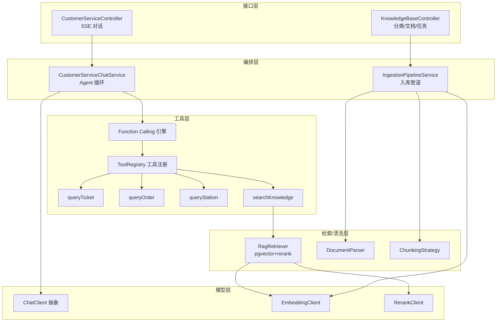

# 智能客服模块详细设计

本文档是智能客服模块（`app/customerservice`）的实施图纸，覆盖 P7-P9 全部任务。参考 Ragent 的成熟实现，针对 12306 单体场景简化。

## 一、模块架构



---

## 二、模型层

### 2.1 ChatClient

两个实现均走 **OpenAI 兼容格式**（Ollama 启用 `/v1/chat/completions` 兼容端点，云端 API 原生兼容），仅 `base_url` 与 `api_key` 不同。

```java
public interface ChatClient {
    String provider();                                              // ollama / cloud
    ChatResponse chat(ChatRequest request);                        // 同步（含 tool_calls）
    StreamCancellationHandle streamChat(ChatRequest request, StreamCallback callback);
}

public class ChatRequest {
    private List<ChatMessage> messages;       // system/user/assistant/tool
    private List<ToolDefinition> tools;       // 可空，无工具时纯对话
    private ModelTarget target;               // 模型名/温度等
}

public class ChatResponse {
    private String content;                   // 文本回复（最终轮）
    private List<ToolCall> toolCalls;         // 工具调用（非空则需执行后回填再调）
}

public class ToolCall {
    private String id;                        // call_xxx，回填 tool 消息时关联
    private String name;                      // 工具名
    private String arguments;                 // JSON 字符串参数
}
```

消息结构（OpenAI 兼容）：
```json
{"role":"system","content":"..."}
{"role":"user","content":"北京到上海明天有什么车"}
{"role":"assistant","content":null,"tool_calls":[{"id":"call_1","type":"function","function":{"name":"queryTicket","arguments":"{\"departure\":\"北京\",\"arrival\":\"上海\",\"date\":\"2026-07-29\"}"}}]}
{"role":"tool","tool_call_id":"call_1","content":"{车次列表JSON}"}
```

`OpenAIStyleChatClient` 解析 SSE `data:` 行，识别 `tool_calls` 增量拼接；`content` 增量通过 `StreamCallback.onToken()` 推送。

### 2.2 EmbeddingClient

```java
public interface EmbeddingClient {
    float[] embed(String text);
    List<float[]> embedBatch(List<String> texts);   // 入库批量用
}
// 实现：CloudEmbeddingClient，POST {base_url}/v1/embeddings
// 维度由模型决定（bge-m3=1024），与 knowledge_chunk.embedding 列定义一致
```

### 2.3 RerankClient

```java
public interface RerankClient {
    List<ScoredChunk> rerank(String query, List<RetrievedChunk> candidates, int topN);
}
// 实现：CloudRerankClient，借鉴 Ragent BaiLianRerankClient
// 降级：Rerank 失败时直接返回原 topK（不阻断流程）
```

---

## 三、Function Calling 引擎（自实现，P9-T1）

### 3.1 工具定义与注册

```java
public class ToolDefinition {
    private String name;
    private String description;
    private Map<String, Object> parameters;   // JSON Schema
}

public interface ToolExecutor {
    String name();
    ToolDefinition definition();
    String execute(Map<String, Object> args);  // 返回 JSON 字符串供 LLM 消费
}

@Component
public class ToolRegistry {
    private final Map<String, ToolExecutor> executors;  // 启动时收集所有 ToolExecutor Bean
    public List<ToolDefinition> allDefinitions();
    public ToolExecutor get(String name);
}
```

### 3.2 Agent 循环

```java
public class FunctionCallingEngine {
    private static final int MAX_ITERATIONS = 5;   // 防死循环

    public void run(List<ChatMessage> messages, List<ToolDefinition> tools,
                    StreamCallback callback, ChatClient client) {
        for (int i = 0; i < MAX_ITERATIONS; i++) {
            ChatResponse resp = client.chat(new ChatRequest(messages, tools, target));
            if (resp.getToolCalls() == null || resp.getToolCalls().isEmpty()) {
                // 无工具调用：流式输出最终回复（实际用 streamChat 重新发起一次流式）
                client.streamChat(new ChatRequest(messages, tools, target), callback);
                return;
            }
            // 有工具调用：加入 assistant(tool_calls) 消息
            messages.add(assistantToolCallMessage(resp));
            for (ToolCall tc : resp.getToolCalls()) {
                callback.onToolCall(tc);                    // SSE 推送 tool_call 事件
                Map<String,Object> args = JSON.parseObject(tc.getArguments());
                String result = registry.get(tc.getName()).execute(args);
                messages.add(toolResultMessage(tc.getId(), result));  // role=tool
            }
            // 循环回到 client.chat，让 LLM 基于 tool 结果继续
        }
        callback.onError("超过最大工具调用轮数");
    }
}
```

> 优化：最终回复轮用 `streamChat` 流式输出；中间工具决策轮用同步 `chat`（不流式，减少开销）。

---

## 四、工具集（P9-T2/T3）

### 4.1 业务工具

```java
@Component
public class QueryTicketTool implements ToolExecutor {
    public String name() { return "queryTicket"; }
    // 注入 TicketService（单体直接调用）
    public String execute(Map args) {
        String departure = (String) args.get("departure");
        String arrival = (String) args.get("arrival");
        String date = (String) args.get("date");
        // 调 TicketService.pageListTicketQuery，返回精简车次 JSON
    }
}
```

工具 JSON Schema：
```json
{"name":"queryTicket","description":"查询某日期两站之间的可用车票车次",
 "parameters":{"type":"object","properties":{
   "departure":{"type":"string","description":"出发站名称"},
   "arrival":{"type":"string","description":"到达站名称"},
   "date":{"type":"string","description":"出发日期 yyyy-MM-dd"}},
   "required":["departure","arrival","date"]}}
```

| 工具 | 参数 | 调用 |
|------|------|------|
| `queryTicket` | departure, arrival, date | TicketService.pageListTicketQuery |
| `queryOrder` | orderSn | OrderService.queryTicketOrderByOrderSn |
| `queryStation` | keyword | StationMapper 模糊查询 |

### 4.2 知识检索工具 searchKnowledge（P9-T3）

```json
{"name":"searchKnowledge","description":"检索 12306 退改规则、购票流程、证件要求等知识库",
 "parameters":{"type":"object","properties":{
   "query":{"type":"string","description":"要检索的问题"}},
   "required":["query"]}}
```

执行流程：query -> EmbeddingClient.embed -> pgvector topK -> RerankClient.rerank -> 拼接 chunks 文本返回。

---

## 五、RAG 检索（P8-T5）

### 5.1 pgvector 检索 SQL

```sql
SELECT id, content, metadata,
       1 - (embedding <=> :query_vec) AS score
FROM knowledge_chunk
WHERE (:catId IS NULL OR category_id = :catId)
ORDER BY embedding <=> :query_vec
LIMIT :topK;
```
- `<=>` 余弦距离，越小越相似；`1 - <=>` 转为相似度分数
- HNSW 索引加速（建表已建）

### 5.2 RagRetriever

```java
public class RagRetriever {
    public List<RetrievedChunk> retrieve(String query, Long categoryId, int topK) {
        float[] vec = embeddingClient.embed(query);
        List<RetrievedChunk> candidates = pgVectorMapper.search(vec, categoryId, topK);  // topK=10
        return rerankClient.rerank(query, candidates, 3);   // 精排取 top3
    }
}
```

---

## 六、数据清洗管道（P8-T1/T2/T3）

### 6.1 文档解析

```java
public interface DocumentParser {
    String getParserType();          // MARKDOWN / TIKA / OCR
    boolean supports(String mimeType);
    String parse(InputStream in, String fileName);  // 返回纯文本
}
@Component
public class DocumentParserSelector {
    public DocumentParser selectByMimeType(String mimeType);  // 默认 fallback TIKA
}
```
| 实现 | 支持 | 说明 |
|------|------|------|
| MarkdownDocumentParser | text/markdown | 按标题结构解析 |
| TikaDocumentParser | pdf/word/excel | Apache Tika 提取文本层 |
| OcrParser（Noop） | 扫描件 pdf | 预留接口，返回未实现标记，二期接 PaddleOCR/多模态 |

### 6.2 切片

```java
public interface ChunkingStrategy {
    ChunkingMode getType();
    List<VectorChunk> chunk(String text, ChunkingOptions config);
}
```
- `StructureAwareTextChunker`：按标题正则 `^#{1,6}\s+` 识别块边界，min/target/max 预算打包，只在块边界切。Word/Markdown 用此。
- `FixedSizeTextChunker`：固定字符 + overlap。纯文本兜底。
- `ChunkingStrategyFactory`：按 `ChunkingMode` 枚举查找。

### 6.3 入库管道

```java
public class IngestionPipelineService {
    @Transactional
    public Long upload(MultipartFile file, Long categoryId, String parserType, String chunkMode) {
        KbDocument doc = saveDocument(file, categoryId, parserType, chunkMode);
        IngestionTask task = createTask(doc.getId());       // status=0
        asyncProcess(doc, task);                            // 异步执行管道
        return task.getId();
    }
    // 异步：parse -> chunk -> embedBatch -> save knowledge_chunk -> task.status=4
    // 失败：task.status=5 + error_msg
}
```
任务状态机：0待处理 -> 1解析 -> 2切片 -> 3向量化 -> 4完成 / 5失败。

---

## 七、对话编排（P9-T4）

```java
@Service
public class CustomerServiceChatService {
    public void streamChat(String question, String sessionId, SseEmitter emitter) {
        if (blank(sessionId)) sessionId = snowflake();
        List<ChatMessage> messages = loadHistory(sessionId);  // Redis
        if (messages.isEmpty()) messages.add(systemPrompt()); // system 首次加入
        messages.add(userMessage(question));

        FunctionCallingEngine engine = new FunctionCallingEngine(...);
        engine.run(messages, toolRegistry.allDefinitions(), sseCallback(emitter), chatClient);

        saveHistory(sessionId, messages);   // Redis + 异步持久化 chat_message
    }
}
```

System Prompt 模板：
```
你是 12306 铁路购票智能客服。可调用以下工具帮用户：
- queryTicket：查车票车次
- queryOrder：查订单状态
- queryStation：查车站信息
- searchKnowledge：查退改规则/购票流程/证件要求等知识

规则：
1. 用户问实时车票/订单 -> 调对应工具，不要凭记忆回答
2. 用户问退改规则/流程/证件 -> 调 searchKnowledge
3. 工具返回结果后用自然语言总结，不要直接吐 JSON
4. 缺少必要参数时向用户追问
5. 不确定时如实说明，不要编造
```

---

## 八、对话历史（P9-T5）

- **Redis**：`chat:history:{sessionId}` -> List<ChatMessage>，保留最近 10 轮（FIFO 裁剪）
- **持久化**：每次对话异步写 `chat_session`（首次）+ `chat_message`（每条），供后台审计
- `ChatMessage`：role / content / toolName / toolArgs / toolResult / createTime

---

## 九、SSE 流式协议

`POST /api/customer-service/chat`，响应 `text/event-stream`：

```
data: {"type":"tool_call","name":"queryTicket","args":{"departure":"北京","arrival":"上海","date":"2026-07-29"}}

data: {"type":"token","content":"为您查询到"}

data: {"type":"token","content":"G1 次..."}

data: {"type":"done","sessionId":"123"}
```

| 事件 type | 含义 |
|-----------|------|
| `tool_call` | LLM 决定调用工具（前端可展示"正在查询..."） |
| `token` | 最终回复的分片流式输出 |
| `done` | 结束，返回 sessionId |
| `error` | 异常 |

前端用 `EventSource` 或 `fetch + ReadableStream` 消费（POST 需用 fetch 流式）。

---

## 十、类清单与任务映射

| 任务 | 核心类 |
|------|--------|
| P7-T1 | ChatClient, OpenAIStyleChatClient, OllamaChatClient, ChatRequest/Response, ToolCall |
| P7-T2 | EmbeddingClient, CloudEmbeddingClient |
| P7-T3 | RerankClient, CloudRerankClient |
| P7-T4 | SseEmitterSender, StreamCallback |
| P8-T1 | DocumentParser, MarkdownDocumentParser, TikaDocumentParser, OcrParser, DocumentParserSelector |
| P8-T2 | ChunkingStrategy, StructureAwareTextChunker, FixedSizeTextChunker, ChunkingStrategyFactory |
| P8-T3 | IngestionPipelineService, KbDocumentMapper, KnowledgeChunkMapper, IngestionTaskMapper |
| P8-T4 | KnowledgeBaseController, KbCategoryService |
| P8-T5 | RagRetriever, PgVectorMapper（自定义 SQL） |
| P9-T1 | ToolDefinition, ToolExecutor, ToolRegistry, FunctionCallingEngine |
| P9-T2 | QueryTicketTool, QueryOrderTool, QueryStationTool |
| P9-T3 | SearchKnowledgeTool |
| P9-T4 | CustomerServiceChatService, CustomerServiceController |
| P9-T5 | ConversationMemoryService（Redis + 持久化） |

---

## 关键设计取舍

- **统一 OpenAI 兼容格式**：Ollama 与云端 API 用同一套请求/解析逻辑，仅配置不同，降低实现成本
- **工具决策同步、最终回复流式**：中间轮用 `chat`（快），最终轮用 `streamChat`（体验好）
- **RAG 作为工具**：知识检索与业务查询统一为工具，LLM 自主路由，无需独立意图分类器
- **rerank 降级**：rerank 失败返回原 topK，不阻断对话
- **OcrParser 预留**：MVP Noop 实现，二期接 OCR，接口已定义
- **MAX_ITERATIONS=5**：防止 LLM 反复调工具死循环